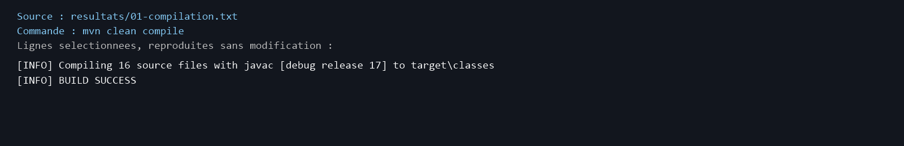
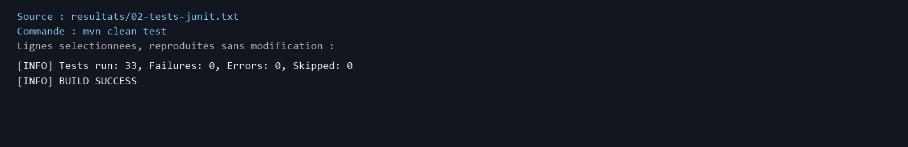
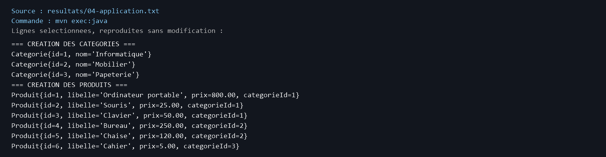
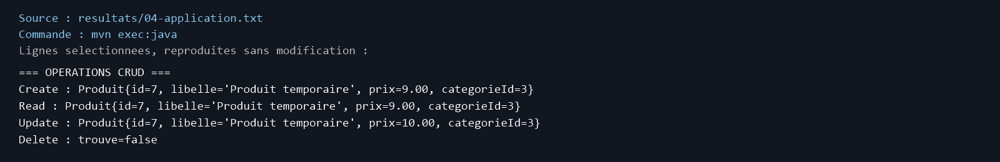
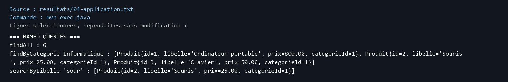
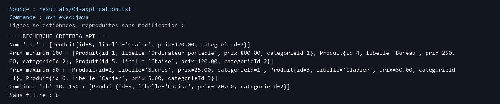
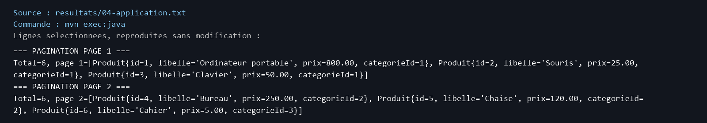
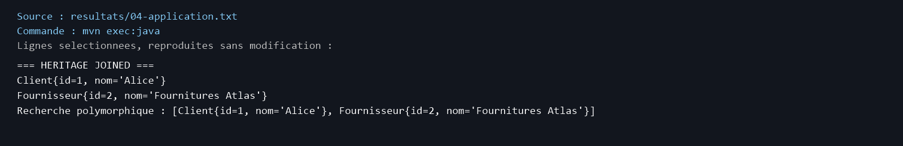
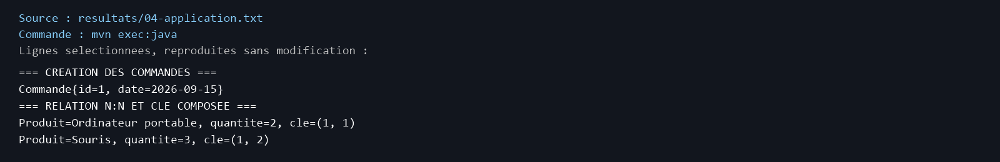
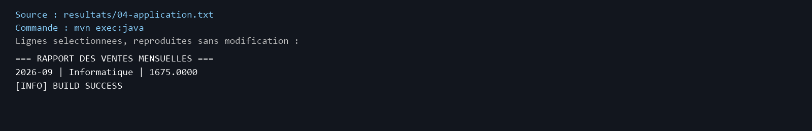

# Lab 6 – Gestion commerciale avec JPA et Hibernate

## Objectif

Ce TP gère des catégories, produits, commandes et utilisateurs avec JPA et Hibernate. Il montre les relations entre entités, les transactions et les requêtes de recherche.

## Technologies utilisées

Java 17, Maven 3.9, JPA 2.2, Hibernate 5.6, MySQL 8, H2 et JUnit 4.

## Travail réalisé

- Catégories, produits, DAO générique et service CRUD.
- Named Queries, Criteria API et pagination.
- Héritage JOINED, commandes N:N avec quantité et clé composée.
- Rapport des ventes du mois précédent par catégorie, calculé en base.
- Servlet `/rapport-ventes` compilé dans le WAR.

## Exécution

Avec le JDK 17 actif, à la racine du projet :

```powershell
mvn clean compile
mvn clean test
mvn clean package
mvn exec:java '-Dexec.mainClass=org.example.App'
```

L'exécution vérifiée utilise **H2 en mémoire** (`APP_DB=h2` par défaut). MySQL n'était pas accessible sur `localhost:3306`. Pour l'utiliser, créer la base `gestion_commerciale`, puis définir `APP_DB=mysql`, `DB_USER` et `DB_PASSWORD` dans l'environnement ; aucun identifiant n'est enregistré dans le dépôt. Le servlet n'a pas été déployé : les installations Tomcat détectées utilisent Jakarta Servlet, tandis que ce TP utilise `javax.servlet`.

## Résultats

| Vérification | Résultat réel |
|---|---|
| Compilation | BUILD SUCCESS |
| Tests JUnit | 33 réussis, 0 échec, 0 erreur |
| Application | BUILD SUCCESS ; démonstration complète |
| Packaging | BUILD SUCCESS ; WAR généré |
| Rapport mensuel | Septembre 2026 : Informatique, 1 675.0000 |

Les sorties complètes sont dans [`resultats/`](resultats/). Les images ci-dessous sont **des extraits de ces journaux réels, pas des captures du terminal intégré**.

## Captures d'écran

1. Compilation : 
2. Tests : 
3. Catégories et produits : 
4. CRUD : 
5. Named Queries : 
6. Criteria API : 
7. Pagination : 
8. Héritage JOINED : 
9. Commandes : 
10. Rapport : 

## Conclusion

Ce lab m'a permis de pratiquer les relations JPA, les requêtes et les transactions. Les tests H2 vérifient les principales fonctionnalités sans serveur MySQL.
